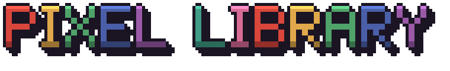
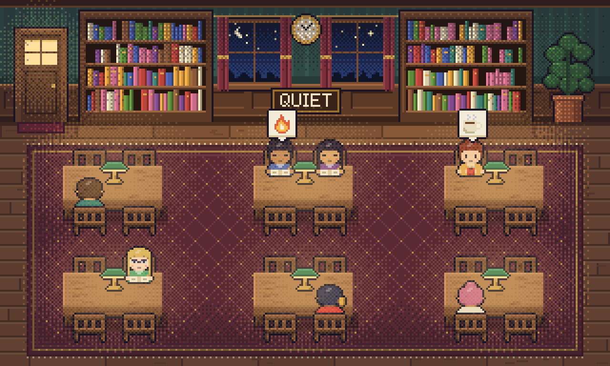
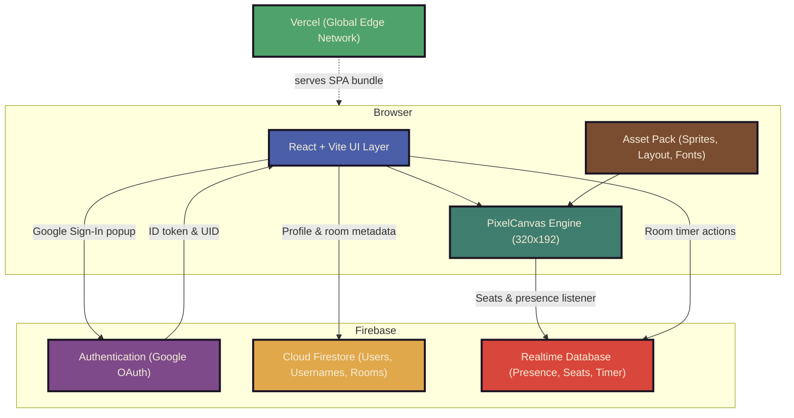
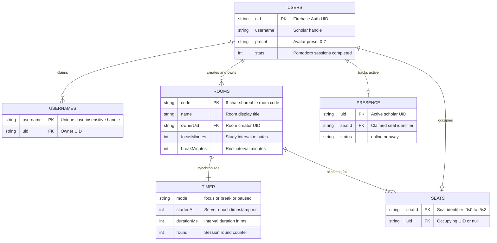
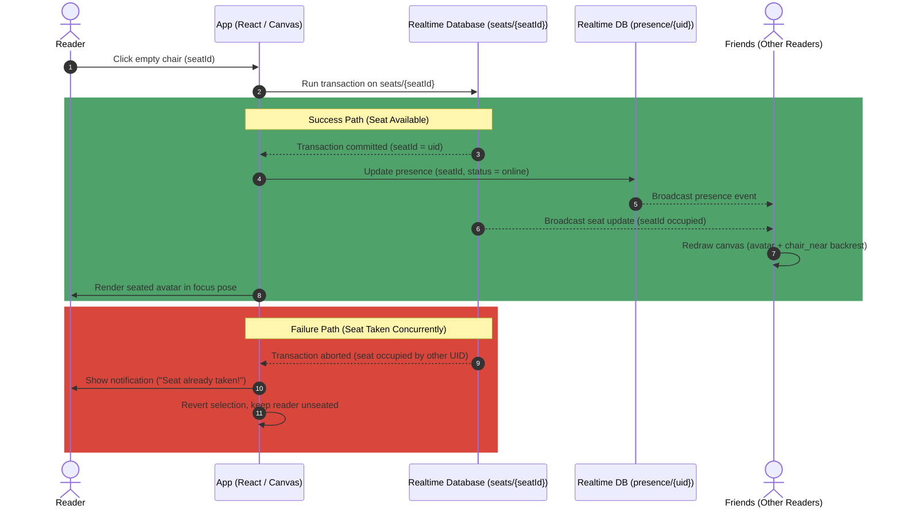
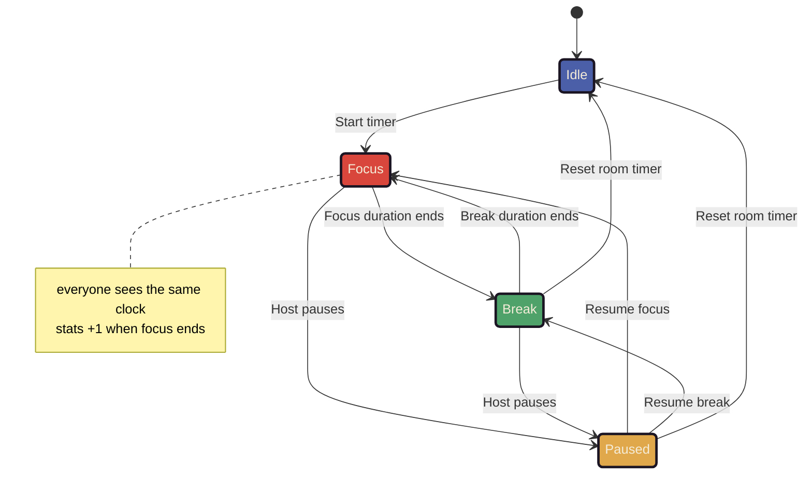

<p align="center">
  
</p>

<p align="center">
  <em>A cozy pixel-art library where friends study together.</em>
</p>



<p align="center" style="margin-top: 14px;">
  
  <br>
  <sub><strong>Tonight's readers:</strong> Aditya · Meera · Kabir · Zoya · Rohan · Tara · Ishaan · Anya</sub>
</p>

<p align="center">
  <a href="#how-it-works">How it works</a> · 
  <a href="#how-to-study-with-friends">Study with friends</a> · 
  <a href="#architecture">Architecture</a> · 
  <a href="#data-model">Data model</a> · 
  <a href="#taking-a-seat">Taking a seat</a> · 
  <a href="#the-shared-pomodoro">Pomodoro</a> · 
  <a href="#build-phases">Build phases</a> · 
  <a href="#tech-stack">Tech stack</a> · 
  <a href="#getting-started">Getting started</a>
</p>

---

## How it works

Follow a reader's journey from stepping through the front doors to focusing together at shared library tables.

```mermaid
flowchart LR
    classDef red fill:#d9463b,stroke:#1b1423,stroke-width:3px,color:#f4ecd8;
    classDef mustard fill:#e0a84a,stroke:#1b1423,stroke-width:3px,color:#f4ecd8;
    classDef green fill:#4fa36a,stroke:#1b1423,stroke-width:3px,color:#f4ecd8;
    classDef blue fill:#4a5fa8,stroke:#1b1423,stroke-width:3px,color:#f4ecd8;
    classDef purple fill:#7e4a8a,stroke:#1b1423,stroke-width:3px,color:#f4ecd8;
    classDef teal fill:#3f7d6e,stroke:#1b1423,stroke-width:3px,color:#f4ecd8;
    classDef pink fill:#c86b86,stroke:#1b1423,stroke-width:3px,color:#f4ecd8;
    classDef wood fill:#7a4d31,stroke:#1b1423,stroke-width:3px,color:#f4ecd8;

    Landing["Landing (hanging sign)"]:::wood --> Join["Join now"]:::mustard
    Join --> Auth["Sign in with Google"]:::blue
    Auth --> Check{"First time?"}:::purple
    Check -- "yes" --> Setup["Pick avatar + username"]:::pink
    Setup --> Lobby["Lobby"]:::teal
    Check -- "no" --> Lobby
    Lobby --> RoomAction["Create room or Join with code"]:::mustard
    RoomAction --> Share["Share link with a friend"]:::blue
    Share --> Reading["Reading room"]:::teal
    Reading --> Seat["Pick a seat"]:::wood
    Seat --> Pomo["Pomodoro together"]:::red
    Pomo --> Stats["Stats saved"]:::green
```



---

## Architecture

The lightweight browser client connects seamlessly to Firebase cloud services for identity, persistence, and live presence.



---

## Data model

Entity relationships define persistent scholar records alongside ephemeral, low-latency room seat and timer states.



---

## Taking a seat

Atomic Realtime Database transactions prevent race conditions when two readers click the same library chair simultaneously.



---

## The shared Pomodoro

A finite state machine coordinates synchronized 25-minute study intervals and 5-minute tea breaks across all readers in the room.



---

## How to study with friends

Gather your study group, share a quiet table, and focus together in five simple steps:

1. **Sign in with Google**: Authenticate in one click to receive your official Library Card. Pick your favorite pixel avatar from 8 handcrafted scholar presets (`aditya`, `meera`, `kabir`, `zoya`, `rohan`, `tara`, `ishaan`, `anya`) and claim your unique username.
2. **Step up to the Front Desk (`/lobby`)**: Name your room (e.g., *"Late Night Calculus"*) and choose your focus/break cycle (25m/5m or 50m/10m). Click **CREATE ROOM** to generate a collision-free 6-character room code.
3. **Share your Table Link**: Click **COPY LINK** on the room sign or share sheet to copy the invite URL (`https://your-domain.vercel.app/room/CODE`). Friends opening the link go directly to your study room.
4. **Pull up a Chair**: Click any of the 24 seats across the 6 library tables. Empty chairs display a bobbing plus sign on hover. Clicking claims the seat atomically with a 2-frame squash animation.
5. **Run the Synchronized Clock**: Any scholar can press **START** on the room-wide Pomodoro clock. When focus completes, a 3-note synthesized Web Audio chime plays, avatars switch to coffee break mode, and focus hours and day streaks increment automatically on your profile!

---

## Build phases

The seven development phases outline our progression from foundation blueprints to deployment.

```mermaid
flowchart LR
    classDef red fill:#d9463b,stroke:#1b1423,stroke-width:3px,color:#f4ecd8;
    classDef mustard fill:#e0a84a,stroke:#1b1423,stroke-width:3px,color:#f4ecd8;
    classDef green fill:#4fa36a,stroke:#1b1423,stroke-width:3px,color:#f4ecd8;
    classDef blue fill:#4a5fa8,stroke:#1b1423,stroke-width:3px,color:#f4ecd8;
    classDef purple fill:#7e4a8a,stroke:#1b1423,stroke-width:3px,color:#f4ecd8;
    classDef teal fill:#3f7d6e,stroke:#1b1423,stroke-width:3px,color:#f4ecd8;
    classDef pink fill:#c86b86,stroke:#1b1423,stroke-width:3px,color:#f4ecd8;
    classDef wood fill:#7a4d31,stroke:#1b1423,stroke-width:3px,color:#f4ecd8;

    P1["Phase 1: README ✅"]:::green --> P2["Phase 2: Setup & engine ✅"]:::green
    P2 --> P3["Phase 3: Landing sign ✅"]:::green
    P3 --> P4["Phase 4: Google sign-in & avatar ✅"]:::green
    P4 --> P5["Phase 5: Lobby ✅"]:::green
    P5 --> P6["Phase 6: Reading room ✅"]:::green
    P6 --> P7["Phase 7: Pomodoro & launch ✅"]:::green
```



---

## Tech stack

Every building block is purpose-selected for cozy pixel-art fidelity and low-latency multiplayer synchronization.

<div align="center">

| Component | Technology | Role & Architecture Details |
| :---: | :--- | :--- |
|  | **React 18 + Vite + TypeScript** | Client application frame, typed component tree, zero CSS frameworks |
|  | **HTML5 Canvas (320×192)** | Virtual retro display, integer-scale pixel renderer (`imageSmoothingEnabled = false`) |
|  | **Firebase Authentication** | Single-click Google Sign-In popup with persistent scholar sessions |
|  | **Cloud Firestore** | Document persistence for scholar profiles, usernames, and room configurations |
|  | **Firebase Realtime Database** | Low-latency atomic seat transactions, live presence, and synced room timers |
|  | **Vercel** | High-speed global edge distribution with SPA rewrites for deep-linked rooms |
|  | **Shared Pomodoro Engine** | Synchronized 25m focus / 5m break room-wide cycles and avatar state flipping |
|  | **Quietpage Typography** | Dedicated bitmap pixel typeface locked to 10px, 20px, 30px, 40px, and 60px |

</div>

---

## Getting started

Follow these steps to establish your local library desk and launch the development server.

1. **Clone the repository**
   ```bash
   git clone https://github.com/your-username/pixel-library.git
   cd pixel-library
   ```

2. **Install project dependencies**
   ```bash
   npm install
   ```

3. **Configure Firebase environment variables**
   ```bash
   cp .env.example .env
   ```
   Fill in your project keys in `.env`:
   ```ini
   VITE_FIREBASE_API_KEY=your_api_key_here
   VITE_FIREBASE_AUTH_DOMAIN=your_project.firebaseapp.com
   VITE_FIREBASE_DATABASE_URL=https://your_project-default-rtdb.firebaseio.com
   VITE_FIREBASE_PROJECT_ID=your_project_id
   VITE_FIREBASE_STORAGE_BUCKET=your_project.appspot.com
   VITE_FIREBASE_MESSAGING_SENDER_ID=your_sender_id
   VITE_FIREBASE_APP_ID=your_app_id
   ```

4. **Launch the development server**
   ```bash
   npm run dev
   ```
   Open your browser at `http://localhost:5173` to take your seat.

---

## Library rules

To preserve the peace and craft of the library, all contributors must observe these rules:

1. **Speak in Whispers**: Keep pull requests focused, atomic, and thoroughly documented.
2. **Respect the Ancient Palette**: Only utilize colours defined in `public/pixel-library-assets/ui/palette.json`.
3. **Preserve the Pixel Grid**: All custom UI containers must be composed from `panel_9slice.png` and rendered using `image-rendering: pixelated` with integer scaling.
4. **Strictly Quiet Typography**: All UI text must render exclusively via `Quietpage.ttf` at discrete sizes of **10px, 20px, 30px, 40px, or 60px**.
5. **No Clutter on the Tables**: Never import outside icon libraries, stock vectors, emoji as UI buttons, or external web fonts.
6. **Card Verification Only**: Authentication is strictly handled via Google OAuth. Do not implement custom password forms.

---

<p align="center">
   <em>Shhh… someone is studying.</em>
</p>
